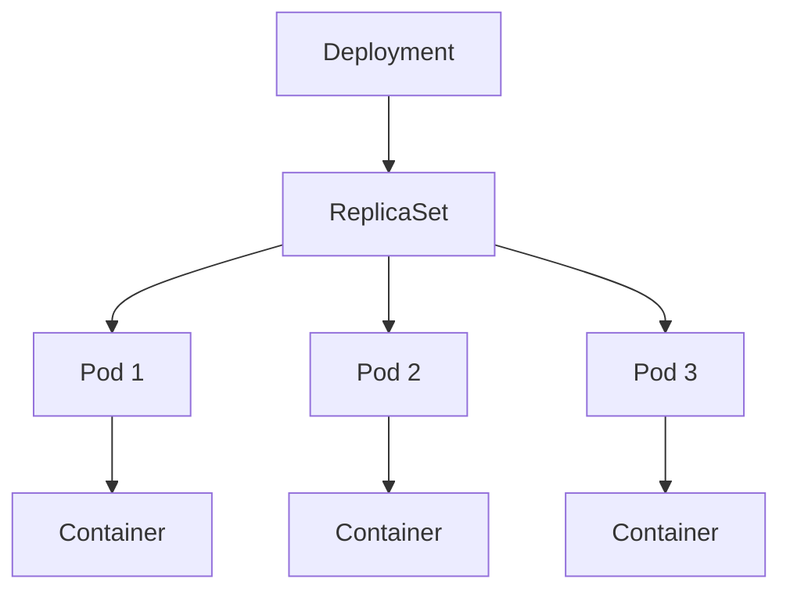

# Kubernetes — Deployment

## 1. Fundamentals

A Deployment manages ReplicaSets and provides:

- **Scaling:** Increase or decrease the number of Pods.
- **Self-healing:** Replace failed Pods through ReplicaSets.
- **Rolling updates:** Gradually replace Pods with a new application version.
- **Rollbacks:** Restore a previous application version.
- **Revision history:** Track Pod template revisions.

### Architecture



| Resource | Responsibility |
|---|---|
| Deployment | Manages application versions |
| ReplicaSet | Maintains the desired Pod count |
| Pod | Hosts one or more containers |
| Container | Runs the application |

## 2. Rolling Update

When the container image changes, the Deployment:

1. Creates a new ReplicaSet.
2. Gradually creates Pods with the new image.
3. Gradually removes Pods with the old image.
4. Completes the update while maintaining availability when properly configured.

Unlike a standalone ReplicaSet, a Deployment automatically replaces existing Pods when its Pod template changes.

## 3. Definition File — nginx-deployment.yaml

```yaml
apiVersion: apps/v1
kind: Deployment

metadata:
  name: nginx-deployment

spec:
  replicas: 3

  selector:
    matchLabels:
      app: nginx

  template:
    metadata:
      labels:
        app: nginx

    spec:
      containers:
        - name: nginx
          image: nginx:1.26
```

The basic definition is almost identical to a ReplicaSet, except for `kind: Deployment`.

## 4. Commands

```bash
kubectl apply -f nginx-deployment.yaml      # Create or update
kubectl get deploy                         # List Deployments
kubectl get rs                             # List ReplicaSets
kubectl get pods                           # List Pods
kubectl describe deploy nginx-deployment   # View details
kubectl edit deploy nginx-deployment       # Edit live configuration
kubectl delete deploy nginx-deployment     # Delete Deployment
```

### Scaling

```bash
kubectl scale deploy nginx-deployment --replicas=5
```

### Update Image

```bash
kubectl set image deploy nginx-deployment nginx=nginx:1.28
```

Syntax: `container-name=new-image`

### Rollout Management

```bash
kubectl rollout status deploy nginx-deployment   # Update progress
kubectl rollout history deploy nginx-deployment  # Revision history
kubectl rollout undo deploy nginx-deployment     # Rollback
kubectl rollout restart deploy nginx-deployment  # Restart Pods
```

## 5. Troubleshooting

| Command | Purpose |
|---|---|
| `kubectl get pods` | Check Pod status |
| `kubectl get rs` | Check old and new ReplicaSets |
| `kubectl describe pod pod-name` | Investigate errors and events |
| `kubectl logs pod-name` | Check application logs |

## 6. ReplicaSet vs Deployment

| Feature | ReplicaSet | Deployment |
|---|---|---|
| Self-healing | Yes | Yes |
| Scaling | Yes | Yes |
| Rolling updates | No | Yes |
| Rollbacks | No | Yes |
| Revision history | No | Yes |

**Production rule:** Manage the Deployment instead of directly modifying its underlying ReplicaSets or Pods.

**Remember:** Deployment = Version management. ReplicaSet = Quantity management. Pod = Hosts containers.


----------------------------------------------------------------------------------------------------------------------------------------


# Kubernetes: Deployment Updates and Rollbacks

## 1. Update a Deployment

**Option 1: Update using YAML**

```
kubectl apply -f deployment-definition.yml
```

- Creates or updates resources based on the YAML configuration.
- If the Pod template changes, Kubernetes triggers a rollout.

**Option 2: Update the container image directly**

```
kubectl set image deployment/myapp-deployment nginx=nginx:1.9.1
```

- Updates the container image directly in the running cluster.
- No YAML editing required.
- Triggers a Rolling Update by default if the image changes.
- Does not modify the original YAML file.

## 2. Deployment Update Strategies

### Recreate

- Scales down the old ReplicaSet to **0 Pods**.
- Creates or scales up the new ReplicaSet with the updated configuration.
- Causes downtime because old Pods terminate before new ones start.
- The old ReplicaSet is generally retained for rollback.

### RollingUpdate (Default)

- Gradually replaces old Pods with new Pods.
- Old and new ReplicaSets coexist during the update.
- Helps maintain application availability.
- Updates are **not necessarily one Pod at a time**.

Controlled by:

- `maxSurge`: Maximum extra Pods allowed during an update (default: 25%).
- `maxUnavailable`: Maximum unavailable Pods allowed during an update (default: 25%).

## 3. Check Update Status and History

**Check rollout status:**

```
kubectl rollout status deployment/myapp-deployment
```

**View revision history:**

```
kubectl rollout history deployment/myapp-deployment
```

## 4. Rollback (Undo Changes)

**Rollback to the previous revision:**

```
kubectl rollout undo deployment/myapp-deployment
```

- Restores the previous Deployment Pod template, including its container image.
- Kubernetes performs the rollback using the Deployment's update strategy.
- Useful when an updated application version fails.

**Rollback to a specific revision:**

```
kubectl rollout undo deployment/myapp-deployment --to-revision=1
```

**Note:** Kubernetes does not automatically roll back a failed Deployment by default.

## 5. Quick Command Summary

| Action             | Command                                                           |
| ------------------ | ----------------------------------------------------------------- |
| Create             | `kubectl create -f deployment-definition.yml`                     |
| Get Deployments    | `kubectl get deployments`                                         |
| Apply YAML changes | `kubectl apply -f deployment-definition.yml`                      |
| Update image       | `kubectl set image deployment/myapp-deployment nginx=nginx:1.9.1` |
| Check rollout      | `kubectl rollout status deployment/myapp-deployment`              |
| View history       | `kubectl rollout history deployment/myapp-deployment`             |
| Rollback           | `kubectl rollout undo deployment/myapp-deployment`                |

**CKA Key Takeaway:**

`Deployment → ReplicaSet → Pods → Containers`

- **Apply:** Create/update resources using YAML.
- **Set image:** Update the container image directly.
- **RollingUpdate:** Gradually replace Pods (default).
- **Recreate:** Terminate old Pods before starting new ones.
- **Rollback:** Restore the previous Deployment Pod template.


$ kubectl create -f deployment-definition.yml --record
  **--record	Records the executed command in a resource annotation.
  **You can see the historical output -> When using -> $ kubectl rollout history deployment/myapp-deployment

CKA takeaway: You can skip --record. Focus on kubectl rollout history, kubectl rollout status, and kubectl rollout undo.

# Commands : 
kubectl rollout status deployment/nginx
kubectl rollout history deployment/nginx
kubectl rollout undo deployment/nginx
kubectl rollout undo deployment/nginx --to-revision=2


## **Rolling Update: maxSurge and maxUnavailable**

```
strategy:
  type: RollingUpdate
  rollingUpdate:
    maxSurge: 25%
    maxUnavailable: 25%
```

- **maxSurge:** Maximum number of additional Pods allowed above the desired replica count during an update. Rounded up.
- **maxUnavailable:** Maximum number of desired Pods allowed to be unavailable during an update. Rounded down.

### **Example: Deployment with 10 replicas**

| Parameter                       | Value  |
| ------------------------------- | ------ |
| Desired replicas                | 10     |
| maxSurge (25%)                  | 3 Pods |
| maxUnavailable (25%)            | 2 Pods |
| Maximum desired Pods            | 13     |
| Minimum targeted available Pods | 8      |

### **How the rolling update works**

| Stage                     | Old Pods | New Pods | Total |
| ------------------------- | -------- | -------- | ----- |
| Initial state             | 10       | 0        | 10    |
| Scale up new ReplicaSet   | 10       | 3        | 13    |
| Scale down old ReplicaSet | 8        | 3        | 11    |
| Scale up new ReplicaSet   | 8        | 5        | 13    |
| Continue rolling update   | ...      | ...      | ...   |
| Update completed          | 0        | 10       | 10    |

**Remember:**

- `maxSurge` controls how many extra Pods can be created.
- `maxUnavailable` controls how much availability can be sacrificed.
- Both default to `25%`.
- Kubernetes gradually replaces old Pods with new Pods while respecting these limits during a normal rolling update.


-----------------------------

# **Kubernetes – Deployment Updates and Rollbacks**

## **1. RollingUpdate Strategy**

Gradually replaces old Pods with new Pods while maintaining application availability. This is the default Deployment strategy.

```
strategy:
  type: RollingUpdate
  rollingUpdate:
    maxSurge: 25%
    maxUnavailable: 25%
```

- `maxSurge`: Ceiling. Maximum extra Pods allowed above the desired replica count. Rounded up.
- `maxUnavailable`: Determines the floor. Maximum desired Pods allowed to be unavailable. Rounded down.

### **Example**

| Parameter              | 4 Replicas | 10 Replicas |
| ---------------------- | ---------- | ----------- |
| maxSurge (25%)         | 1          | 3           |
| maxUnavailable (25%)   | 1          | 2           |
| Ceiling (desired Pods) | 5          | 13          |
| Floor (available Pods) | 3          | 8           |

**Mental model:** Floor ← Desired replicas → Ceiling

## **2. Recreate Strategy**

Terminates all existing Pods before creating new Pods with the updated configuration. Causes application downtime.

```
strategy:
  type: Recreate
```

**Example:** 4 old Pods → 0 Pods → 4 new Pods.

- No `maxSurge` or `maxUnavailable`.
- Remove the entire `rollingUpdate` section when switching to `Recreate`.
- Changing the strategy alone does not restart Pods.

## **3. Update the Container Image**

```
kubectl set image deployment/frontend simple-webapp=kodekloud/webapp-color:v2
```

Directly updates the container image without manually editing YAML. Triggers a rollout if the image changes.

## **4. Rollout and Troubleshooting Commands**

| Command                                                    | Purpose                                              |
| ---------------------------------------------------------- | ---------------------------------------------------- |
| `kubectl get deployments`                                  | Check Deployment status                              |
| `kubectl get rs`                                           | Check old and new ReplicaSets                        |
| `kubectl get pods`                                         | Check Pod status                                     |
| `kubectl describe deployment frontend`                     | Check strategy, image, conditions and scaling events |
| `kubectl edit deployment frontend`                         | Modify Deployment configuration                      |
| `kubectl rollout status deployment/frontend`               | Monitor rollout progress                             |
| `kubectl rollout history deployment/frontend`              | View revision history                                |
| `kubectl rollout undo deployment/frontend`                 | Roll back to previous revision                       |
| `kubectl rollout undo deployment/frontend --to-revision=2` | Roll back to a specific revision                     |

## **5. minReadySeconds**

```
minReadySeconds: 20
```

A new Pod must remain Ready for at least 20 seconds before Kubernetes considers it Available.

## **6. ReplicaSet Behavior**

- Updating the Pod template creates a new ReplicaSet unless a matching one already exists.
- The old ReplicaSet is scaled down to zero after a successful update.
- Old ReplicaSets are generally retained for rollback.
- During rollback, Kubernetes can reuse an existing ReplicaSet.

## **7.&#x20;**`--record`**&#x20;Flag (Deprecated)**

Previously used to record the command responsible for a Deployment change in its rollout history.

Modern alternative: `kubernetes.io/change-cause` annotation.

**Not required for maintaining rollout history or performing rollbacks.**


### Kubernetes: Get Container Name (JSONPath)

```bash
kubectl get deployment frontend -o jsonpath='{.spec.template.spec.containers[*].name}'
```

**Output:**
```text
simple-webapp
```

**Explanation:**
- `kubectl get deployment frontend`: Reads the Deployment configuration from the cluster.
- `-o jsonpath`: Extracts a specific field.
- `.spec.template.spec.containers[*].name`: Returns the container name(s) defined in the Pod template.
- `[*]`: Selects all containers.

**Important:** Kubernetes reads the **live configuration stored in the cluster**, not the local YAML file.

**Update the container image:**
```bash
kubectl set image deployment/frontend simple-webapp=kodekloud/webapp-color:v2
```

**Remember:** `YAML → kubectl apply → Cluster` and `kubectl get → Reads cluster configuration`.


