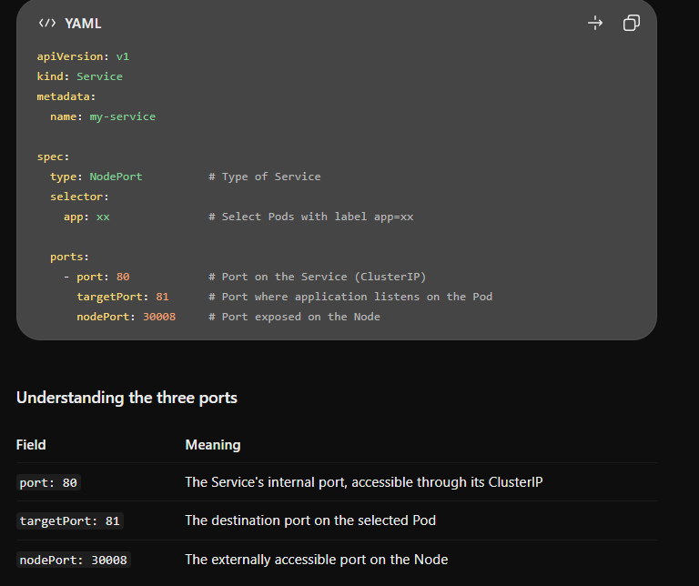
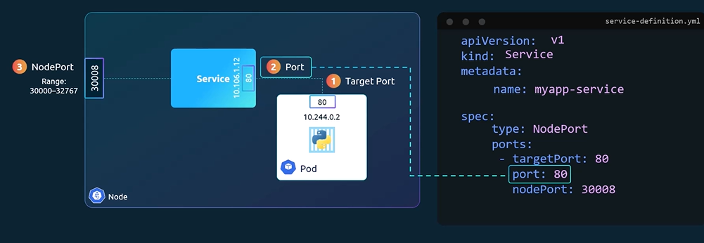

## Kubernetes Services

### 1. Simple Explanation
- **Pod:** Runs the application. Its IP can change.
- **Deployment:** Manages Pods, replicas, and updates.
- **Service:** Provides stable networking access to Pods.
- A Service is **not a physical server, Pod, or container**.
- Services select Pods using **labels and selectors**.

### 2. Types of Services

| Type | Purpose |
|---|---|
| ClusterIP | Internal cluster communication (default) |
| NodePort | External access using `NodeIP:NodePort` |
| LoadBalancer | External access using a load balancer |

### 3. NodePort Example

External client: `192.168.1.10`  
Node IP: `192.168.1.2`  
NodePort: `30008`  
Pod IP: `10.244.0.2`

**Traffic flow:**

External Client → NodeIP:30008 → Service → Pod:targetPort

```bash
curl http://192.168.1.2:30008
```

- NodePort exposes a **Service**, not the entire Node.
- Default NodePort range: `30000–32767`.
- The same NodePort is generally accessible on every Node.
- Traffic can be forwarded to matching Pods on other Nodes.

### 4. Service YAML

```yaml
apiVersion: v1
kind: Service
metadata:
  name: nginx-service
spec:
  type: NodePort
  selector:
    app: nginx
  ports:
    - port: 80
      targetPort: 80
      nodePort: 30008
```

**Ports:**
- `port`: Port exposed by the Service.
- `targetPort`: Port where the application listens inside the Pod.
- `nodePort`: Port exposed on the Node.

### 5. Advanced / CKA Notes
- Service provides a stable **ClusterIP and DNS name**.
- `kube-proxy` (or an alternative implementation) handles Service traffic forwarding.
- Service selectors must match Pod labels.
- Services typically distribute connections across eligible, ready Pods.
- **EndpointSlices** track backend Pod IPs and ports.
- If a Pod is replaced, EndpointSlices are updated automatically.
- If labels don't match, the Service has no matching backend Pods.
- NodePort requires network/firewall access to the Node IP and port.
- LoadBalancer requires a supported load balancer implementation.

### 6. Useful kubectl Commands

```bash
# Create deployment
kubectl create deployment nginx --image=nginx --replicas=3

# Expose using NodePort
kubectl expose deployment nginx --port=80 --target-port=80 --type=NodePort

# View services
kubectl get svc

# Inspect service
kubectl describe svc nginx

# Check matching pod labels
kubectl get pods --show-labels

# Check service endpoints
kubectl get endpointslice -l kubernetes.io/service-name=nginx
```

**Remember:** Deployment manages Pods. Service provides stable access to them.




